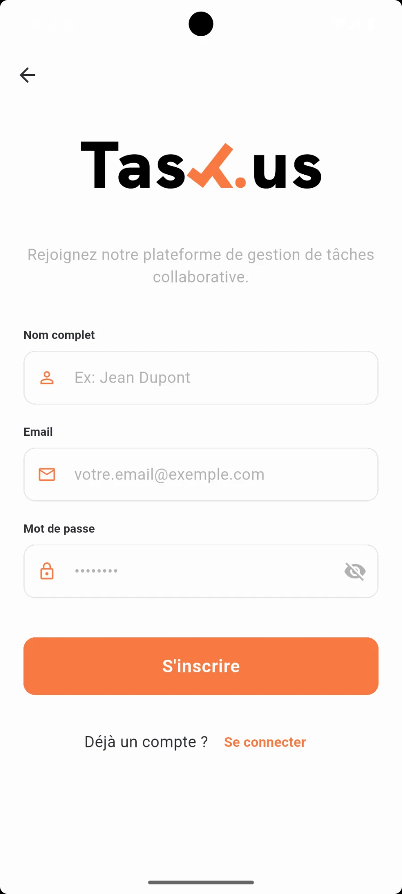
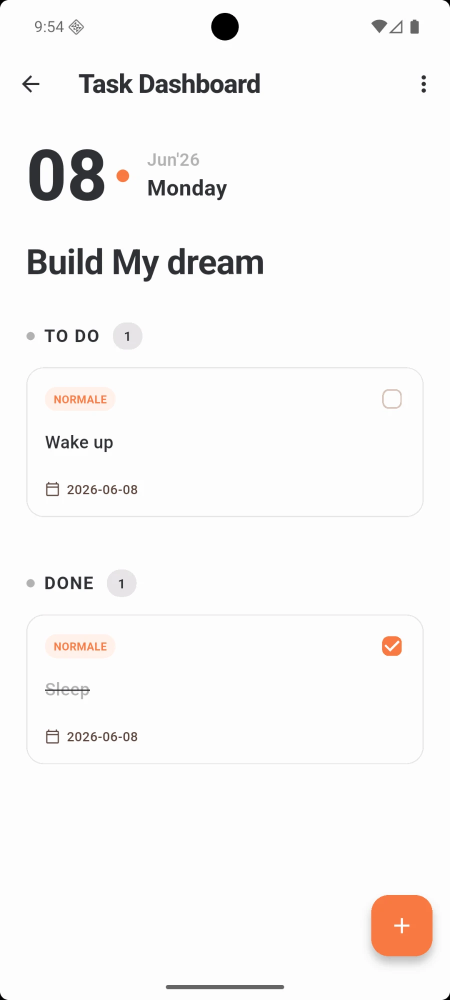
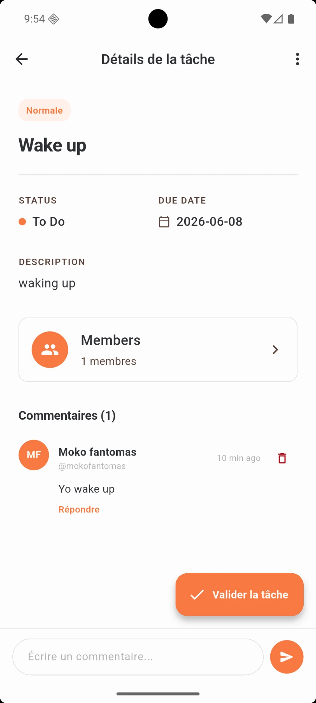

# Task Us

Application de **gestion de tâches collaborative** (style Kanban) : projets partagés, listes, tâches, étiquettes, commentaires, pièces jointes, notifications en temps réel et notifications push.

Ce dépôt est un **monorepo** qui regroupe :

| Dossier | Rôle | Stack |
| --- | --- | --- |
| [`frontend/`](frontend) | Application mobile | Flutter / Dart, Riverpod, Dio, Firebase Cloud Messaging |
| [`backend/`](backend) | API REST + temps réel | Node.js, TypeScript, Express 5, Sequelize, PostgreSQL, Socket.IO |

---

## Aperçu

<table>
  <tr>
    <td align="center"></td>
    <td align="center"></td>
    <td align="center"></td>
    <td align="center"></td>
  </tr>
  <tr>
    <td align="center"><b>Démarrage</b></td>
    <td align="center"><b>Inscription</b></td>
    <td align="center"><b>Tableau des tâches</b><br><sub>To Do / Done, priorité, échéance</sub></td>
    <td align="center"><b>Détails d'une tâche</b><br><sub>membres, commentaires, validation</sub></td>
  </tr>
</table>

---

## Sommaire

1. [Structure du dépôt](#structure-du-dépôt)
2. [Prérequis](#prérequis)
3. [Démarrage rapide](#démarrage-rapide)
4. [Backend](#backend)
   - [Configuration (.env)](#configuration-env)
   - [Scripts npm](#scripts-npm)
   - [Base de données](#base-de-données)
   - [Authentification](#authentification)
   - [Rôles et permissions](#rôles-et-permissions)
   - [Référence de l'API](#référence-de-lapi)
   - [Temps réel (Socket.IO)](#temps-réel-socketio)
   - [Notifications push (Firebase)](#notifications-push-firebase)
   - [Pièces jointes](#pièces-jointes)
   - [Format des erreurs](#format-des-erreurs)
5. [Frontend](#frontend)
   - [Fonctionnalités](#fonctionnalités)
   - [Architecture (MVVM + Riverpod)](#architecture-mvvm--riverpod)
   - [Charte graphique](#charte-graphique)
   - [Configuration Firebase](#configuration-firebase)
   - [Adresse de l'API](#adresse-de-lapi)
6. [Conventions et contribution](#conventions-et-contribution)
7. [Dépannage](#dépannage)

---

## Structure du dépôt

```
.
├── README.md               ← ce fichier
├── .gitignore              ← règles communes (OS, IDE, secrets)
├── .editorconfig
├── docs/screenshots/       ← captures d'écran utilisées dans ce README
│
├── backend/                ← API Node.js / TypeScript
│   ├── src/
│   │   ├── index.ts        ← point d'entrée (Express + HTTP + Socket.IO)
│   │   ├── config/         ← configuration Sequelize (TS + .cjs pour la CLI)
│   │   ├── db/             ← instance Sequelize, connexion
│   │   ├── models/         ← modèles (User, Projet, Collaborator, List, Task, Label…)
│   │   ├── migrations/     ← migrations sequelize-cli (.cjs)
│   │   ├── seeders/        ← données de démo (vide pour l'instant)
│   │   ├── routes/         ← déclaration des routes Express
│   │   ├── controllers/    ← logique des endpoints + validation Zod
│   │   ├── middlewares/    ← auth JWT, rôles, upload, gestion d'erreurs
│   │   ├── services/       ← e-mail (SMTP), Firebase (FCM), Socket.IO
│   │   ├── utils/          ← JWT, erreurs, accès projet, notifications…
│   │   └── types/          ← extensions de types Express
│   ├── .env.example
│   ├── .sequelizerc
│   ├── package.json
│   └── tsconfig.json
│
└── frontend/               ← application Flutter (MVVM + Riverpod)
    ├── lib/                ← code de l'app (models, services, viewmodels, views, utils)
    ├── images/             ← logo et icônes
    ├── test/
    ├── android/ ios/ web/ linux/ macos/ windows/
    └── pubspec.yaml
```

Chaque application est **indépendante** : elle a ses propres dépendances, son propre `.gitignore` et se lance depuis son dossier.

---

## Prérequis

| Outil | Version conseillée | Utilisé par |
| --- | --- | --- |
| [Node.js](https://nodejs.org/) | 20 LTS ou plus (testé avec 24) | backend |
| npm | fourni avec Node.js | backend |
| [PostgreSQL](https://www.postgresql.org/) | 14 ou plus | backend |
| [Flutter](https://docs.flutter.dev/get-started/install) | SDK compatible Dart `^3.11.0` | frontend |
| Docker *(optionnel)* | — | lancer PostgreSQL rapidement |

Vérification :

```bash
node -v && npm -v && flutter --version && psql --version
```

---

## Démarrage rapide

### 1. Cloner le dépôt

```bash
git clone <url-du-depot> col-to-do
cd col-to-do
```

### 2. Lancer PostgreSQL

Avec Docker :

```bash
docker run -d --name col_todo_db -e POSTGRES_USER=postgres -e POSTGRES_PASSWORD=postgres -e POSTGRES_DB=col_todo -p 5432:5432 postgres:16
```

Ou avec une installation locale :

```bash
createdb -U postgres col_todo
```

### 3. Backend

```bash
cd backend
cp .env.example .env        # puis adapter les valeurs (au minimum JWT_SECRET et DB_*)
npm install
npm run db:migrate          # crée les tables
npm run dev                 # http://localhost:3000
```

Le serveur affiche `PostgreSQL connection established.` puis `Server is running at http://0.0.0.0:3000`.

Test rapide :

```bash
curl -X POST http://localhost:3000/api/auth/register -H "Content-Type: application/json" -d '{"full_name":"Alice","email":"alice@example.com","password":"motdepasse123"}'
```

### 4. Frontend

Dans un autre terminal :

```bash
cd frontend
# placer google-services.json dans android/app/ (voir « Configuration Firebase »)
flutter pub get
flutter run                 # sur un émulateur ou un téléphone Android
```

---

## Backend

### Configuration (.env)

Copier `backend/.env.example` vers `backend/.env`. Le fichier `.env` n'est **jamais** versionné.

| Variable | Défaut | Description |
| --- | --- | --- |
| `NODE_ENV` | `development` | `development`, `test` ou `production` (choisit la config Sequelize) |
| `PORT` | `3000` | Port HTTP de l'API |
| `DB_HOST` | `localhost` | Hôte PostgreSQL |
| `DB_PORT` | `5432` | Port PostgreSQL |
| `DB_NAME` | `col_todo` | Base principale |
| `DB_NAME_TEST` | `col_todo_test` | Base utilisée quand `NODE_ENV=test` |
| `DB_USER` | `postgres` | Utilisateur PostgreSQL |
| `DB_PASSWORD` | `postgres` | Mot de passe PostgreSQL |
| `JWT_SECRET` | — **obligatoire** | Clé de signature des jetons JWT (longue chaîne aléatoire) |
| `JWT_EXPIRES_IN_SECONDS` | `604800` | Durée de validité du jeton (7 jours) |
| `SMTP_HOST` / `SMTP_PORT` | — | Serveur SMTP pour les e-mails (réinitialisation de mot de passe) |
| `SMTP_USER` / `SMTP_PASS` | — | Identifiants SMTP |
| `SMTP_FROM` | — | Adresse d'expéditeur |
| `FRONTEND_URL` | `http://localhost:5173` | URL du client : utilisée pour le lien de réinitialisation et l'origine CORS de Socket.IO |
| `UPLOAD_DIR` | `uploads` | Dossier de stockage des pièces jointes (servi en statique sur `/<UPLOAD_DIR>`) |
| `GOOGLE_APPLICATION_CREDENTIALS` | `./firebase-service-account.json` | Chemin vers le compte de service Firebase |
| `FIREBASE_SERVICE_ACCOUNT_JSON` | — | Alternative : contenu JSON du compte de service dans une variable |

Générer un `JWT_SECRET` :

```bash
node -e "console.log(require('crypto').randomBytes(48).toString('hex'))"
```

### Scripts npm

À lancer depuis `backend/` :

| Commande | Effet |
| --- | --- |
| `npm run dev` | Démarre en développement avec rechargement automatique (nodemon + tsx) |
| `npm run build` | Compile TypeScript vers `dist/` |
| `npm start` | Lance la version compilée (`dist/index.js`) |
| `npm run db:migrate` | Applique les migrations |
| `npm run db:migrate:undo` | Annule la dernière migration |
| `npm run db:seed` | Exécute les seeders |

Mise en production :

```bash
npm ci && npm run build && NODE_ENV=production npm run db:migrate && NODE_ENV=production npm start
```

### Base de données

Le schéma est géré par **sequelize-cli** (configuration dans `.sequelizerc` → `src/config/database.cjs`). Les migrations se trouvent dans `src/migrations/`.

| Table | Contenu |
| --- | --- |
| `user` | Comptes (nom, e-mail, hash du mot de passe, avatar, jeton de réinitialisation) |
| `projet` | Projets (titre, description, couleur, propriétaire, archivage) |
| `collaborator` | Membres d'un projet : rôle (`admin`, `member`, `viewer`) et statut d'invitation (`pending`, `accepted`) |
| `list` | Colonnes d'un projet, ordonnées par `position` |
| `task` | Tâches : titre, description, priorité (1 à 3), échéance, assigné, position, état terminé |
| `label` | Étiquettes propres à un projet (nom, couleur) |
| `task_label` | Liaison tâches ↔ étiquettes |
| `comment` | Commentaires sur une tâche, avec réponses (`parent_id`) |
| `attachment` | Fichiers attachés à une tâche |
| `notification` | Notifications in-app d'un utilisateur |
| `device_token` | Jetons FCM des appareils (`android` / `ios`) |

Créer une nouvelle migration :

```bash
npx sequelize-cli migration:generate --name nom-de-la-migration
```

Puis renommer le fichier généré en `.cjs` (le projet est en ES modules).

### Authentification

- Inscription / connexion renvoient `{ user, token }`.
- Les routes protégées attendent l'en-tête :

  ```
  Authorization: Bearer <token>
  ```

- Mots de passe hachés avec **bcrypt**, jetons signés avec **JWT** (`JWT_SECRET`).
- Mot de passe oublié : un e-mail contenant `FRONTEND_URL` + jeton est envoyé ; le jeton est valable **1 heure**.

### Rôles et permissions

Chaque utilisateur a un rôle par projet. Les rôles sont hiérarchiques :

| Rôle | Rang | Peut… |
| --- | --- | --- |
| `owner` | 4 | Tout (créateur du projet) |
| `admin` | 3 | Modifier / archiver / supprimer le projet, gérer les membres |
| `member` | 2 | Créer et modifier listes, tâches, étiquettes |
| `viewer` | 1 | Consulter uniquement |

Un membre invité est en statut `pending` tant qu'il n'a pas accepté l'invitation.

### Référence de l'API

Préfixe : `/api`. 🔒 = jeton requis.

#### Auth — `/api/auth`

| Méthode | Route | Corps | Description |
| --- | --- | --- | --- |
| POST | `/register` | `full_name`, `email`, `password` (≥ 8) | Créer un compte |
| POST | `/login` | `email`, `password` | Se connecter |
| POST | `/forgot-password` | `email` | Envoyer un lien de réinitialisation |
| POST | `/reset-password` | `token`, `password` | Définir un nouveau mot de passe |
| GET 🔒 | `/me` | — | Utilisateur courant |

#### Projets — `/api/projects` 🔒

| Méthode | Route | Rôle min. | Corps | Description |
| --- | --- | --- | --- | --- |
| GET | `/` | — | — | Mes projets (propriétaire ou membre accepté) |
| POST | `/` | — | `title`, `description?`, `background_color?` | Créer un projet |
| GET | `/:id` | membre | — | Détail d'un projet |
| PUT | `/:id` | admin | idem création | Modifier |
| DELETE | `/:id` | admin | — | Supprimer |
| PATCH | `/:id/archive` | admin | `is_archived` | Archiver / désarchiver |
| POST | `/:id/members` | admin | `email`, `role?` | Inviter un membre |
| POST | `/:id/members/accept` | invité | — | Accepter l'invitation |
| POST | `/:id/members/decline` | invité | — | Refuser l'invitation |
| PUT | `/:id/members/:userId` | admin | `role` | Changer le rôle |
| DELETE | `/:id/members/:userId` | admin | — | Retirer un membre |
| GET | `/:id/stats` | membre | — | Statistiques : `total`, `done`, `late`, `pending`, `by_member` |

#### Listes — `/api/projects/:projectId/lists` 🔒

| Méthode | Route | Rôle min. | Corps | Description |
| --- | --- | --- | --- | --- |
| GET | `/` | viewer | — | Listes du projet |
| POST | `/` | member | `title`, `position?` | Créer une liste |
| PATCH | `/reorder` | member | tableau `[{ "id", "position" }]` | Réordonner les listes |
| PUT | `/:id` | member | `title`, `position?` | Modifier |
| DELETE | `/:id` | member | — | Supprimer |

#### Tâches — `/api` 🔒

| Méthode | Route | Corps | Description |
| --- | --- | --- | --- |
| GET | `/lists/:listId/tasks` | — | Tâches d'une liste |
| POST | `/lists/:listId/tasks` | `title`, `description?`, `priority?` (1–3), `due_date?` (AAAA-MM-JJ), `assigned_to?`, `position?` | Créer |
| GET | `/tasks/:id` | — | Détail |
| PUT | `/tasks/:id` | idem création | Modifier |
| DELETE | `/tasks/:id` | — | Supprimer |
| PATCH | `/tasks/:id/move` | `list_id`, `position` | Déplacer (glisser-déposer) |
| PATCH | `/tasks/:id/done` | — | Basculer terminé / non terminé |
| PATCH | `/tasks/:id/assign` | `assigned_to` (id ou `null`) | Assigner |

#### Étiquettes 🔒

| Méthode | Route | Rôle min. | Corps | Description |
| --- | --- | --- | --- | --- |
| GET | `/api/projects/:projectId/labels` | viewer | — | Étiquettes du projet |
| POST | `/api/projects/:projectId/labels` | member | `name`, `color?` | Créer |
| PUT | `/api/labels/:id` | member | `name?`, `color?` | Modifier |
| DELETE | `/api/labels/:id` | member | — | Supprimer |
| POST | `/api/tasks/:taskId/labels` | member | `label_id` | Ajouter à une tâche |
| DELETE | `/api/tasks/:taskId/labels/:labelId` | member | — | Retirer d'une tâche |

#### Commentaires — `/api/tasks/:taskId/comments` 🔒

| Méthode | Route | Corps | Description |
| --- | --- | --- | --- |
| GET | `/` | — | Commentaires (arborescence avec réponses) |
| POST | `/` | `content`, `parent_id?` | Commenter / répondre |
| PUT | `/:id` | `content` | Modifier |
| DELETE | `/:id` | — | Supprimer |

#### Pièces jointes — `/api/tasks/:taskId/attachments` 🔒

| Méthode | Route | Corps | Description |
| --- | --- | --- | --- |
| GET | `/` | — | Liste des fichiers |
| POST | `/` | `multipart/form-data`, champ `file` (≤ 10 Mo) | Envoyer un fichier |
| DELETE | `/:id` | — | Supprimer |

#### Notifications — `/api/notifications` 🔒

| Méthode | Route | Corps | Description |
| --- | --- | --- | --- |
| GET | `/` | — | Mes notifications |
| PATCH | `/read-all` | — | Tout marquer comme lu |
| PATCH | `/:id/read` | — | Marquer une notification comme lue |
| POST | `/devices` | `token`, `platform?` (`android` \| `ios`) | Enregistrer un appareil pour le push |
| DELETE | `/devices` | `token` | Désenregistrer un appareil |

### Temps réel (Socket.IO)

Le serveur Socket.IO écoute sur le **même port** que l'API. Le client rejoint des « salles » puis reçoit les événements :

| Émis par le client | Salle rejointe |
| --- | --- |
| `join:project` (`projectId`) | `project:<id>` |
| `join:task` (`taskId`) | `task:<id>` |
| `join:user` (`userId`) | `user:<id>` |

| Événement reçu | Salle | Déclencheur |
| --- | --- | --- |
| `task:updated` | projet | Tâche modifiée / basculée terminée |
| `task:moved` | projet | Tâche déplacée |
| `task:assigned` | projet | Tâche assignée |
| `comment:added` | projet et tâche | Nouveau commentaire |
| `notification:new` | utilisateur | Nouvelle notification (invitation, assignation…) |

### Notifications push (Firebase)

Optionnel. Pour activer l'envoi via **Firebase Cloud Messaging** :

1. Console Firebase → Paramètres du projet → Comptes de service → *Générer une nouvelle clé privée*.
2. Placer le fichier dans `backend/firebase-service-account.json` (ignoré par Git), **ou** coller son contenu dans `FIREBASE_SERVICE_ACCOUNT_JSON`.

Sans ces identifiants, le serveur démarre normalement et affiche simplement un avertissement : les notifications push sont désactivées. Les jetons invalides sont supprimés automatiquement de la base.

### Pièces jointes

Les fichiers sont stockés sur disque dans `UPLOAD_DIR` (créé automatiquement) et servis à l'adresse `http://<hôte>:<port>/<UPLOAD_DIR>/<fichier>`. Taille maximale : 10 Mo.

### Format des erreurs

Toutes les erreurs ont la forme :

```json
{ "error": "Message" }
```

Les erreurs de validation (Zod) renvoient un **400** avec le détail par champ :

```json
{ "error": "Validation failed", "details": { "email": ["Invalid email"] } }
```

Codes courants : `400` validation, `401` non authentifié, `403` droits insuffisants, `404` introuvable, `500` erreur serveur.

---

## Frontend

Application **Flutter** (`frontend/`), pensée d'abord pour le **mobile (Android)**. Elle consomme l'API REST du backend et reçoit les notifications push via Firebase.

### Fonctionnalités

- **Authentification** : inscription, connexion, session persistante (jeton JWT stocké dans `flutter_secure_storage`, déconnexion automatique sur une réponse 401)
- **Projets** : liste, création (titre, description, couleur), suppression
- **Tableau des tâches** : colonnes *To Do* / *Done*, priorité, échéance, case à cocher pour terminer
- **Détails d'une tâche** : statut, description, membres, commentaires avec réponses, bouton « Valider la tâche »
- **Membres** : invitation par e-mail, changement de rôle, retrait
- **Inbox / notifications** : notifications in-app, badge de non-lus, acceptation ou refus des invitations
- **Recherche** de tâches
- **Paramètres**
- **Notifications push** (Firebase Cloud Messaging) avec ouverture de l'écran concerné au clic

Navigation principale (barre du bas) : **Projects · Search · Inbox · Settings**.

### Stack

| Besoin | Paquet |
| --- | --- |
| Gestion d'état | `flutter_riverpod` |
| Requêtes HTTP | `dio` |
| Stockage sécurisé du jeton | `flutter_secure_storage` |
| Préférences locales | `shared_preferences` |
| Notifications push | `firebase_core`, `firebase_messaging` |
| Dates / formats | `intl` |
| Sélection multiple | `multi_dropdown` |

### Architecture (MVVM + Riverpod)

```
frontend/lib/
├── main.dart              ← initialise Firebase et Riverpod, choisit Login ou MainLayout selon la session
├── models/                ← objets métier immuables (Project, Task, Comment, Member, User, Notification)
├── services/              ← accès aux données : un service par ressource de l'API
│   ├── api_client.dart    ← instance Dio unique : URL de base, jeton JWT, gestion du 401
│   ├── auth_service.dart, project_service.dart, task_service.dart,
│   │   comment_service.dart, member_service.dart, notification_service.dart
│   ├── push_notification_service.dart   ← FCM : permission, jeton appareil, réception
│   └── secure_storage_service.dart
├── viewmodels/            ← logique de présentation et état (Notifier / AsyncNotifier Riverpod)
├── views/
│   ├── screens/           ← écrans (login, register, projects, dashboard, task details, inbox…)
│   └── widgets/           ← composants réutilisables (cartes, bottom sheet, modales, barre de navigation)
└── utils/
    ├── theme.dart         ← thème centralisé (palette ci-dessous)
    └── navigation.dart    ← navigatorKey global (navigation depuis une notification)
```

Règle : les **vues** ne parlent qu'aux **viewmodels**, qui passent par les **services**. Aucun appel HTTP dans un widget.

### Charte graphique

Toutes les couleurs sont définies dans `lib/utils/theme.dart`. N'utiliser que celles-ci :

| Nom | Hex | Usage |
| --- | --- | --- |
| Brilliance | `#FDFCFC` | Fond principal |
| Violet Essence | `#E6E4E6` | Bordures, séparateurs, états désactivés |
| Palladium | `#B1B1B1` | Textes et icônes secondaires |
| Night Black | `#2F3035` | Texte principal, titres |
| Precious Persimmon | `#F87941` | **Couleur primaire** : boutons, états actifs |
| No Way Rosé | `#F9B095` | Couleur secondaire : badges, accents |

Les règles complètes (architecture et palette) destinées aux assistants IA sont dans `frontend/.agents/rules/`.

### Configuration Firebase

L'application appelle `Firebase.initializeApp()` au démarrage : **la configuration Firebase est obligatoire** pour la lancer.

- **Android** : placer le fichier `google-services.json` du projet Firebase dans `frontend/android/app/` (package `com.example.col_to_do`). Ce fichier est ignoré par Git : chaque développeur le récupère depuis la console Firebase (Paramètres du projet → Vos applications).
- **iOS** : ajouter `GoogleService-Info.plist` dans `frontend/ios/Runner/` (pas encore fourni).
- **Web / desktop** : non configurés pour Firebase pour l'instant ; l'application ne démarrera pas sur ces cibles sans options Firebase.

Côté backend, le compte de service doit appartenir au **même projet Firebase** (voir [Notifications push](#notifications-push-firebase)).

### Adresse de l'API

L'URL est définie dans `lib/services/api_client.dart` :

| Plateforme | URL utilisée |
| --- | --- |
| Émulateur Android | `http://10.0.2.2:3000` |
| Web, iOS, desktop | `http://localhost:3000` |

Pour un **téléphone Android physique**, remplacer `10.0.2.2` par l'adresse IP locale du PC (même réseau Wi-Fi). Le backend écoute sur `0.0.0.0`, il est donc joignable depuis le réseau local.

### Commandes

À lancer depuis `frontend/` :

| Commande | Effet |
| --- | --- |
| `flutter pub get` | Installer les dépendances |
| `flutter run` | Lancer sur l'appareil sélectionné |
| `flutter test` | Lancer les tests |
| `flutter analyze` | Analyse statique (règles `flutter_lints`) |
| `flutter build apk --release` | Générer un APK Android |


---

## Conventions et contribution

- **Un seul dépôt Git** à la racine ; ne pas recréer de `.git` dans `frontend/` ou `backend/`.
- Messages de commit au format [Conventional Commits](https://www.conventionalcommits.org/fr/) avec la portée de l'application :

  ```
  feat(backend): ajout des statistiques par membre
  fix(frontend): correction du glisser-déposer
  docs: mise à jour du README
  ```

- Branches : `main` (stable), `feat/<sujet>`, `fix/<sujet>`.
- Ne jamais commiter de secrets ni de configuration Firebase (`.env`, `firebase-service-account.json`, `google-services.json`, `GoogleService-Info.plist`) : seuls les fichiers `*.example` sont versionnés.

### Initialiser le nouveau dépôt

```bash
git init -b main
git add .
git commit -m "chore: initialisation du monorepo (frontend Flutter + backend Node.js)"
git remote add origin <url-du-nouveau-depot>
git push -u origin main
```

---

## Dépannage

| Problème | Solution |
| --- | --- |
| `Failed to start server` / `ECONNREFUSED 5432` | PostgreSQL n'est pas lancé ou `DB_*` est incorrect dans `.env` |
| `database "col_todo" does not exist` | Créer la base (`createdb col_todo`) puis `npm run db:migrate` |
| `JWT_SECRET is not configured` | Renseigner `JWT_SECRET` dans `backend/.env` |
| `Firebase Service Account file not found` | Avertissement normal si le push n'est pas configuré |
| L'émulateur Android n'atteint pas l'API | Vérifier que le backend tourne ; l'émulateur utilise `10.0.2.2` |
| Le téléphone physique n'atteint pas l'API | Mettre l'IP locale du PC dans `lib/services/api_client.dart` |
| L'app plante au démarrage (`Firebase.initializeApp`) | `google-services.json` manquant dans `frontend/android/app/` |
| E-mail de réinitialisation non reçu | Vérifier les variables `SMTP_*` |
